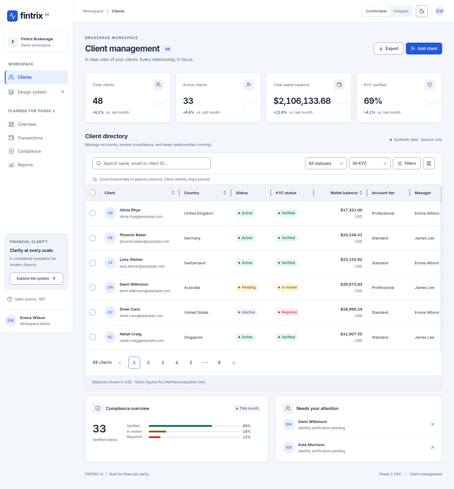
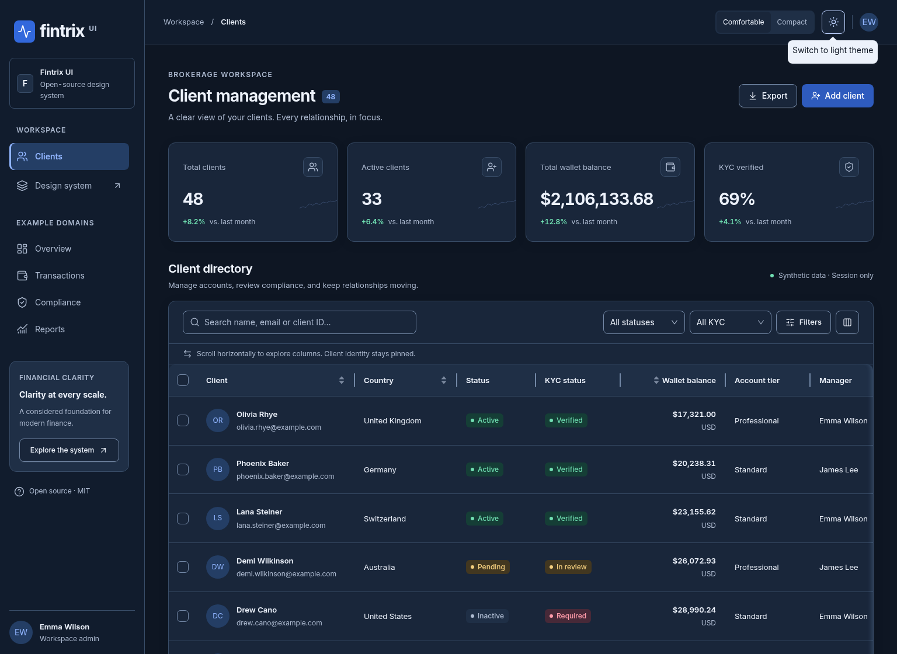
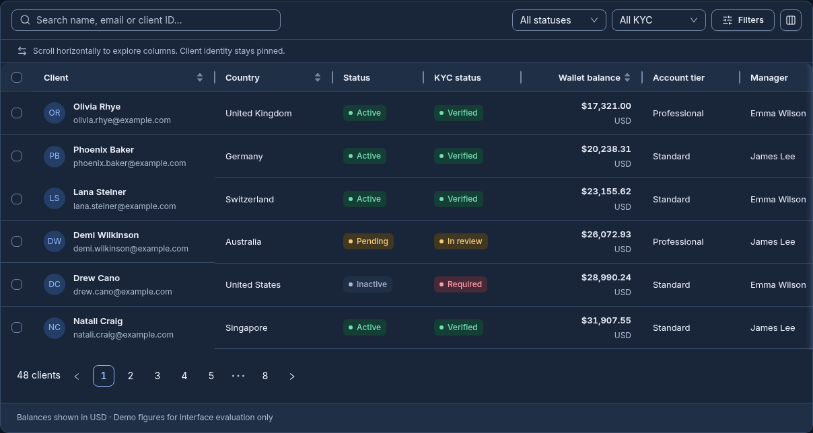
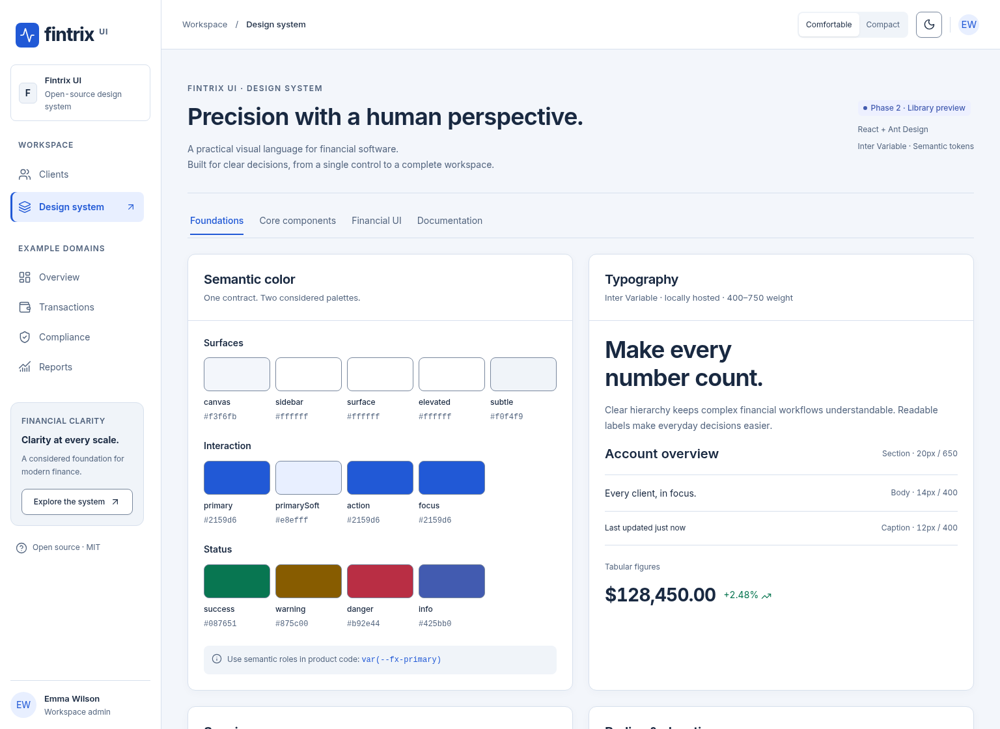
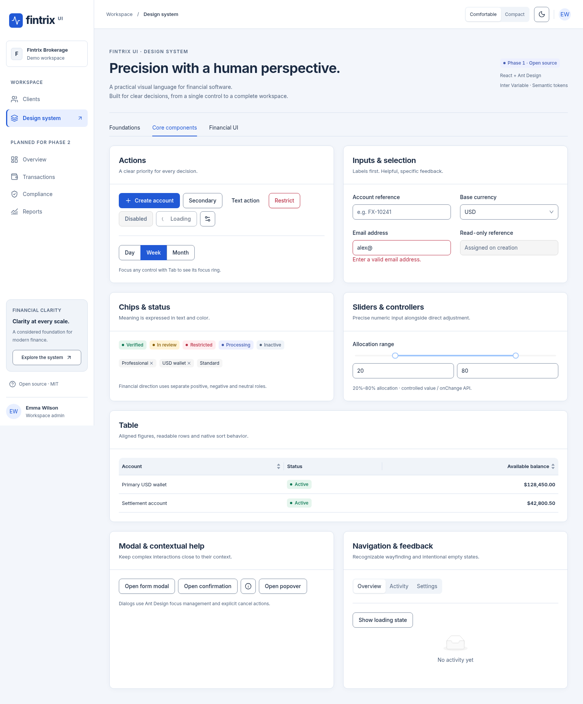
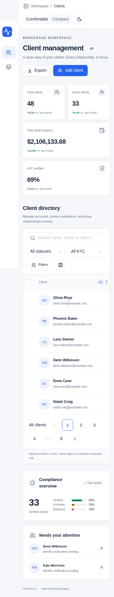
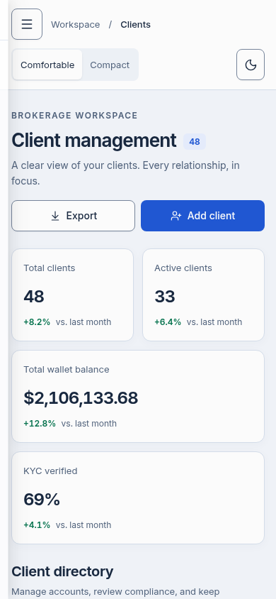

# Fintrix UI

**Financial clarity, at every scale.** An original open-source React design system foundation for brokerage CRMs, FinTech operations and enterprise financial dashboards.

Fintrix UI pairs Ant Design's established behavior with a considered visual language: locally hosted Inter, blue actions, calm neutral surfaces, clear status labels and precise tabular figures. Financial interfaces carry dense information and consequential decisions; readable text, predictable controls and accessible feedback are part of the design, not finishing touches.

**Phase 1 · Architecture & working proof of concept · MIT**

## Brokerage CRM — Light



## Brokerage CRM — Dark

Distinct canvas, navigation, card and elevated surfaces keep dark mode comfortable and legible.



## Compact data grid

Compact mode reduces spacing while preserving text size. The table supports native sorting, selection and pagination, combined filters, pinned identity, pointer/keyboard column resizing, numeric width controls and column visibility/order.



## Foundations & semantic tokens

The interactive Foundations view documents color roles, the actual Inter font, spacing, radius, elevation, layout, density and motion.



## Component gallery

Interactive examples cover actions, fields, statuses, controllers, tables, overlays, navigation, empty/loading feedback and financial compositions. Both themes and densities work throughout.



## Mobile experience

Labeled drawer navigation, 44px touch controls, reflowing metrics, single-column forms and discoverable table scrolling support smaller screens.

<p>
  
  
</p>

All previews are captured from the actual running application with Playwright. Additional light/dark, financial and tablet captures live in [docs/screenshots](docs/screenshots).

## Web demo deployment

The `Publish web demo` workflow builds and deploys the application from `main` to GitHub Pages. The `build:demo` script sets the project subpath `/Fintrix-UI/`, including lazy-loaded chunks and font assets. Pull requests build the same deployment artifact without publishing it.

Repository owners must enable **Settings → Pages → Build and deployment → Source: GitHub Actions** once. Then run **Actions → Publish web demo → Run workflow** for the initial deployment; subsequent pushes to `main` publish automatically. The deployment job records the live URL in its `github-pages` environment after a successful release. No npm package is published by this workflow.

## Run locally

Validated with Node 24 and npm 11.

```sh
npm ci
npm run dev
npm run build
npm test
npm run storybook
npm run build-storybook
```

Open `http://localhost:5173`. Use **Clients** for the working CRM or **Design system** for the Foundations, Core components and Financial UI tabs. The top bar changes color mode and density independently.

## Reuse the foundations

```tsx
import { FintrixProvider, Button, StatusIndicator } from "./src/system";
import "@fontsource-variable/inter/wght.css";
import "antd/dist/reset.css";
import "./src/styles.css";

<FintrixProvider initialMode="dark" initialDensity="compact">
  <Button type="primary">Create client</Button>
  <StatusIndicator label="Verified" tone="success" />
</FintrixProvider>;
```

- `src/system`: typed tokens, CSS variable adapter, theme provider, reusable controls and table/header/modal primitives.
- `src/demo`: 48 synthetic clients and session-only CRM logic. Search, status/KYC/balance filtering, CSV export, selection and validated create/edit workflows work locally.
- Storybook: isolated component examples, full gallery and CRM with theme/density toolbar controls.

Ant Design is the only complete UI foundation. Lucide provides consistent icons. Inter is self-hosted through Fontsource under SIL OFL 1.1. No proprietary trading-platform assets are used. Fintrix UI is not an official Ant Design theme and does not copy MetaTrader or cTrader.

Read the [architecture](docs/architecture.md), [token contract](docs/tokens.md), [visual refinement decisions](docs/refinement.md), [Ant Design evaluation](docs/antd-evaluation.md) and [validation evidence](docs/validation.md).

## Browser & accessibility checks

```sh
npx playwright install --with-deps chromium
npm run test:e2e
# Or use an existing compatible Chromium:
PLAYWRIGHT_CHROMIUM_EXECUTABLE_PATH=/path/to/chromium npm run test:e2e
```

The config uses `/usr/bin/chromium` when available and Playwright's managed browser otherwise. Tests regenerate screenshots in `docs/screenshots`. Vitest/RTL verifies provider state, combined filters, invalid form submission and token contrast targets. Browser checks include all theme/density combinations, desktop/tablet/mobile layouts, font loading, pointer/keyboard resizing, drawer/modal focus behavior and targeted axe scans.

These checks do not constitute full WCAG certification. Additional browsers, assistive technology, touch devices, extreme zoom and RTL require broader validation.

## Phase 1 boundaries

No backend, transactions, authentication, live market data, npm publishing or deployment. Data and preferences reset on reload. Trends are illustrative. Column reordering uses explicit controls; drag reordering and an optional mobile card view await further evaluation. Large datasets are unbenchmarked.

Pages are lazy-loaded, but Ant Design's shared runtime remains substantial. Phase 2 should prioritize accessibility research, library packaging and tree shaking, measured bundle budgets, localization and large-data benchmarks before expanding the component catalog.
