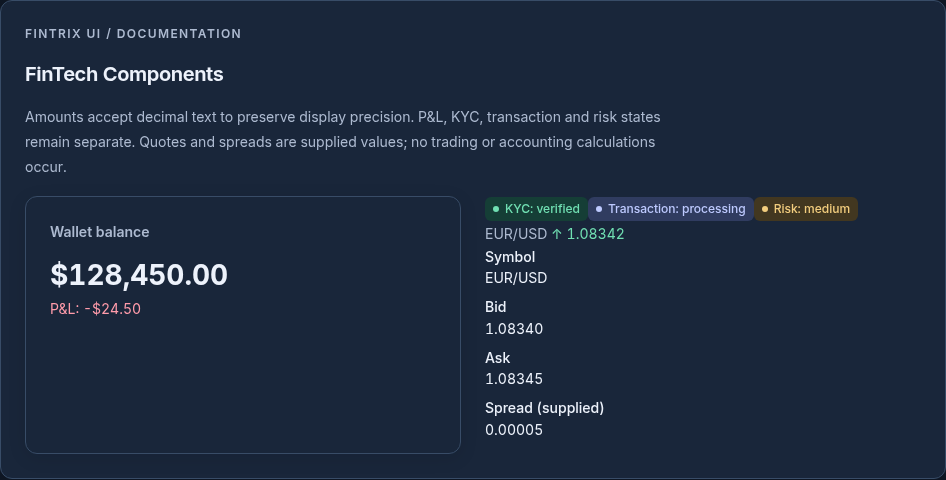
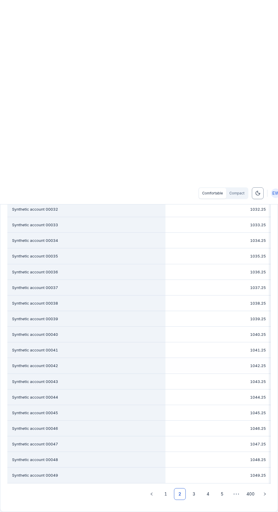
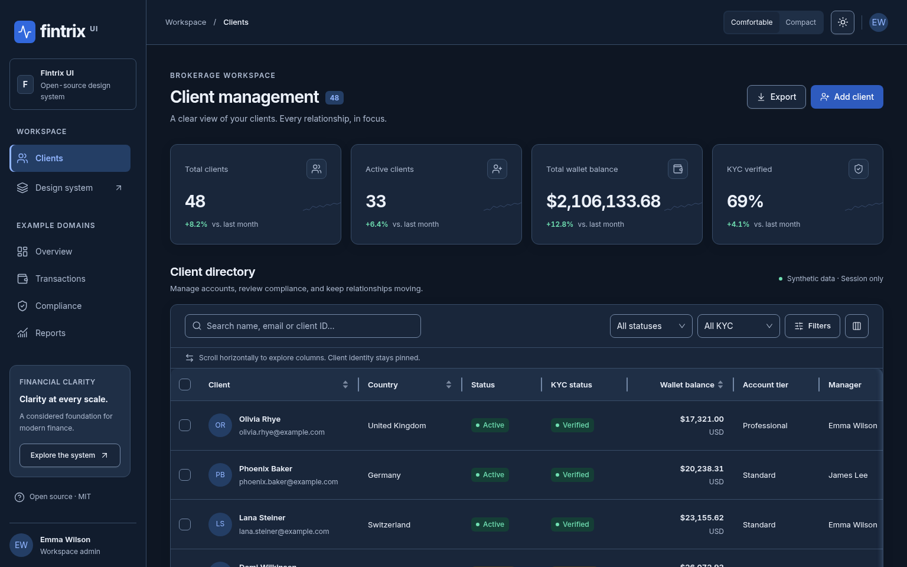

# Fintrix UI

An independent, MIT-licensed React design system for financial software teams.
Build brokerage CRMs, risk dashboards and wallet interfaces with semantic
financial states, readable data grids and a shared light/dark token system.

Built on Ant Design 6, React and self-hosted Inter Variable. Phase 3 adds curated iconography, semantic icon tones, typed theme customization
and independent packed-consumer validation. The provisional package is private and **not published to npm**.


_Real Chromium capture: semantic palette, typography, spacing and density._


_Reusable financial components using synthetic values, with explicit text states._


_Controlled visibility, keyboard resizing, sorting and pagination._


_Preserved Phase 1 client management workflow, fixed columns and financial metrics._

## Install and use

Requires Node 24 for repository tooling. Runtime peers: React/React DOM 18.3 or 19
and Ant Design 6 (see the [Phase 3 validation report](docs/phase-three-report.md)). Package name availability is not
claimed; install the locally packed artifact until a release is approved.

```sh
npm ci
npm run build
npm pack --workspace fintrix-ui-preview --pack-destination /tmp
# In your separate React app:
npm install /tmp/fintrix-ui-preview-0.2.0.tgz antd react react-dom
```

```tsx
import {
  FintrixProvider,
  WalletBalanceCard,
  PnLIndicator,
} from "fintrix-ui-preview";
import "fintrix-ui-preview/styles.css";
import "fintrix-ui-preview/fonts.css"; // optional, self-hosted Inter

export function App() {
  return (
    <FintrixProvider initialMode="dark" initialDensity="comfortable">
      <WalletBalanceCard
        value="128450.00"
        currency="USD"
        detail={<PnLIndicator value="-24.50" currency="USD" />}
      />
    </FintrixProvider>
  );
}
```

Use `useFintrixTheme()` inside the provider to switch mode/density. Tokens are
available from `fintrix-ui-preview/tokens`, scoped CSS variables, and
`fintrix-ui-preview/tokens.json`. Amounts are presentation only; use decimal text
for precision. No trading, payments, ledger or live market integration is included.

## Explore

```sh
npm run dev              # build first; public showcase at localhost:5173
npm run storybook        # component stories at localhost:6006
```

The default view is the public system gallery. Its Documentation tab has 14
sections, copyable React examples and a synthetic 10k-row grid. Select Clients to
open the CRM, or use `/?view=crm`. Theme and density controls work across both.

[GitHub Pages demo / expected publication URL](https://morimdn.github.io/Fintrix-UI/)
may show the previously approved phase. Phase 2 has **not been deployed**. Its
workflow is manual-only and must be explicitly authorized after review.

## App shell

The sidebar and header stay stationary while content scrolls independently.
Only overflowing sidebar navigation scrolls; brand/workspace and profile remain
anchored. The mobile navigation drawer retains keyboard focus management.
[Responsive behavior and regression checks](docs/shell-refinement.md).


_Real application capture: aligned header, stationary sidebar and bottom profile._

## Components

| Area                 | Available APIs                                                                                                      |
| -------------------- | ------------------------------------------------------------------------------------------------------------------- |
| Actions              | Button, ButtonGroup, IconButton                                                                                     |
| Forms                | Input/TextArea, Select, Checkbox, Radio, Switch, Slider, InputNumber, RangeController, Form, DatePicker, TimePicker |
| Data                 | DataTable, DataGrid, ColumnResizeHandle, ResizableHeaderCell                                                        |
| Navigation           | Tabs, Breadcrumb, Menu, Dropdown, Pagination                                                                        |
| Feedback             | StatusIndicator, Chip, Alert, Progress, Skeleton, Empty, notification, message                                      |
| Overlays             | Modal, FormModal, Drawer, Tooltip, Popover                                                                          |
| Financial summaries  | CurrencyAmount, formatCurrency, PnLIndicator, WalletBalanceCard, AccountSummary, FinancialKPICard                   |
| Financial operations | KYCStatus, ClientStatus, TransactionStatus, RiskLevelIndicator                                                      |
| Quotes               | SymbolPriceDisplay, BidAskDisplay (supplied spread)                                                                 |
| Composition          | Card, Space, MetricCard (legacy synthetic sparkline)                                                                |

Standard controls retain Ant Design props; wrappers add Fintrix behavior where
needed. [Usage and decision guidance](docs/components.md).

## Visual evidence

All images are captured from the running application by Playwright. No generated
mockups are used. [Capture details and asset index](docs/screenshots/README.md).

| Preview                        | Image                                                                                         |
| ------------------------------ | --------------------------------------------------------------------------------------------- |
| Button states and core gallery | [Light](docs/screenshots/components-light.png) / [Dark](docs/screenshots/components-dark.png) |
| Financial dashboard gallery    | [Light](docs/screenshots/financial-light.png) / [Dark](docs/screenshots/financial-dark.png)   |
| Tokens and typography          | [Light](docs/screenshots/tokens-light.png) / [Dark](docs/screenshots/tokens-dark.png)         |
| Public documentation           | [Light](docs/screenshots/library-light.png) / [Dark](docs/screenshots/library-dark.png)       |
| Mobile                         | [Documentation](docs/screenshots/library-mobile.png) / [CRM](docs/screenshots/mobile.png)     |

## Validate

```sh
npm run build
npm test
npm run build-storybook
npm run validate:consumer
npx playwright install --with-deps chromium
npm run test:e2e
npx playwright test --config playwright.consumer.config.ts
node scripts/package-metrics.mjs
npm run build:demo
```

The independent consumer is installed from `npm pack` in a fresh temporary
directory outside this workspace. Its build and browser checks verify actual
package exports, declarations, CSS, fonts, provider, forms and financial display.
[Architecture](docs/architecture.md) · [Validation and limits](docs/phase-two-report.md)
· [Tokens](docs/tokens.md) · [Accessibility](docs/accessibility.md)
· [Design-to-code mapping](docs/design-to-code.md) · [Contributing](CONTRIBUTING.md)
· [Releases](docs/releases.md).

Fintrix UI is not an official MetaTrader, cTrader or Ant Design product. See
[MIT license](LICENSE) and [third-party attribution](docs/third-party-notices.md).

## Iconography and customization

Use the Showcase **Iconography** tab to search 36 Lucide icons, preview sizes,
strokes and tones in either theme, and copy React examples.

```tsx
import { Wallet } from "lucide-react";
import { FintrixIcon, WalletBalanceCard } from "fintrix-ui-preview";

<FintrixIcon icon={Wallet} tone="primary" size={24} />;
<WalletBalanceCard value="12500.25" currency="EUR"
  icon={<Wallet size={24} />} iconTone="success" />;
```

See [customization](docs/customization.md) for theme overrides, density, icon
semantics, control variants and DataGrid extensions. See the
[release checklist](docs/releases.md) for owner decisions before publication.
