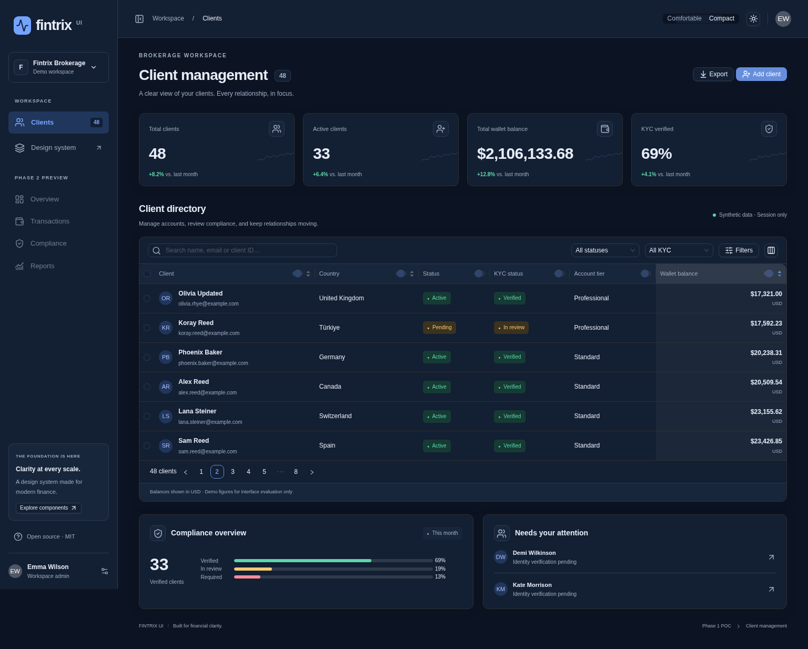
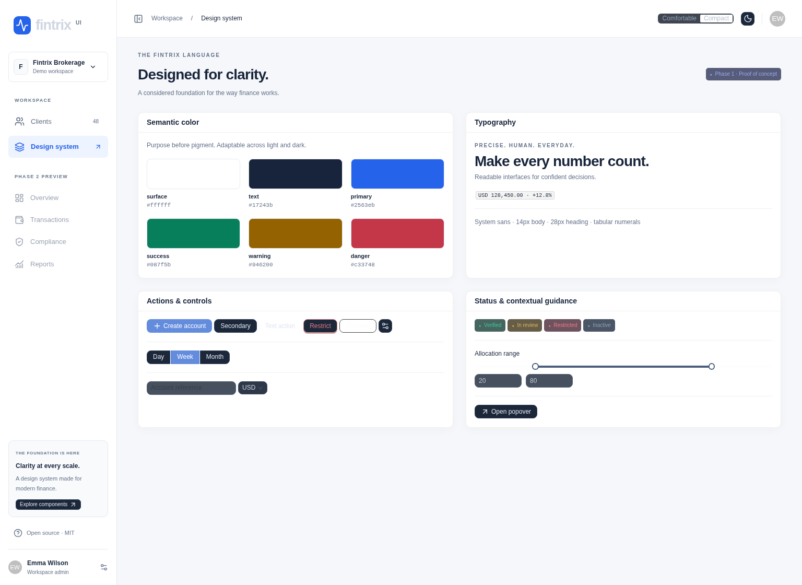

# Fintrix UI

An original, open-source React design system foundation for brokerage CRMs, FinTech operations and enterprise financial dashboards. **Phase 1: architecture and working proof of concept.** MIT licensed; not an official Ant Design theme or a copy of a trading platform.


## Run locally

Node 24 and npm 11 were used for validation.

```sh
npm ci
npm run dev
npm run build
npm test
npm run storybook
npm run build-storybook
```

The showcase runs at `http://localhost:5173`. Switch between **Clients** and **Design system** in the sidebar. The top bar changes light/dark color mode and comfortable/compact density independently.

## What works

- Typed semantic tokens, scoped CSS variables, React theme provider and Ant Design theme adapters.
- Buttons, button groups, accessible icon buttons, inputs, selects, chips/status labels, controlled dual range/number controller, tooltip and popover.
- Generic typed data table with native sort, selection, fixed identity column, horizontal overflow and pagination. The CRM adds search, combined filters, CSV export, column visibility/order/width controls.
- Validated client details/create modal; session-only save updates the directory and summary metrics.
- Metric cards, compliance widget and attention list using 48 synthetic clients.
- Storybook gallery and variants with theme/density toolbar controls.

`src/system` contains reusable foundations. `src/demo` owns the synthetic client domain and workflow. Ant Design supplies component behavior; Lucide supplies icons. Cool neutrals, blue actions, generous spacing and tabular financial figures form the original visual direction. No external proprietary assets are used.

Read [architecture and usage](docs/architecture.md), [semantic tokens](docs/tokens.md), and [Ant Design evaluation / Phase 2 recommendations](docs/antd-evaluation.md).

## Browser verification and screenshots

```sh
# Install a supported browser first, or set the path to an installed Chromium:
npx playwright install --with-deps chromium
PLAYWRIGHT_CHROMIUM_EXECUTABLE_PATH=/path/to/chromium npm run test:e2e
```

The configuration uses `/usr/bin/chromium` when present, otherwise Playwright's managed browser. Playwright captures real running-app screenshots into `docs/screenshots`; these are not mockups. Tests cover search, edit/save, creation validation, column controls, sorting, pagination, mobile filters, and dark/compact switching. Vitest/RTL covers token parity, filtering, provider state and invalid form submission.




## Phase 1 boundaries

No backend, transactions, authentication, live market data, npm publishing or deployment. Edits and preferences reset on reload. Trend figures are illustrative. Column resizing and reordering use explicit keyboard-accessible controls; richer drag interactions and large-dataset benchmarks remain Phase 2 work. See the evaluation for evidence and remaining gaps.
