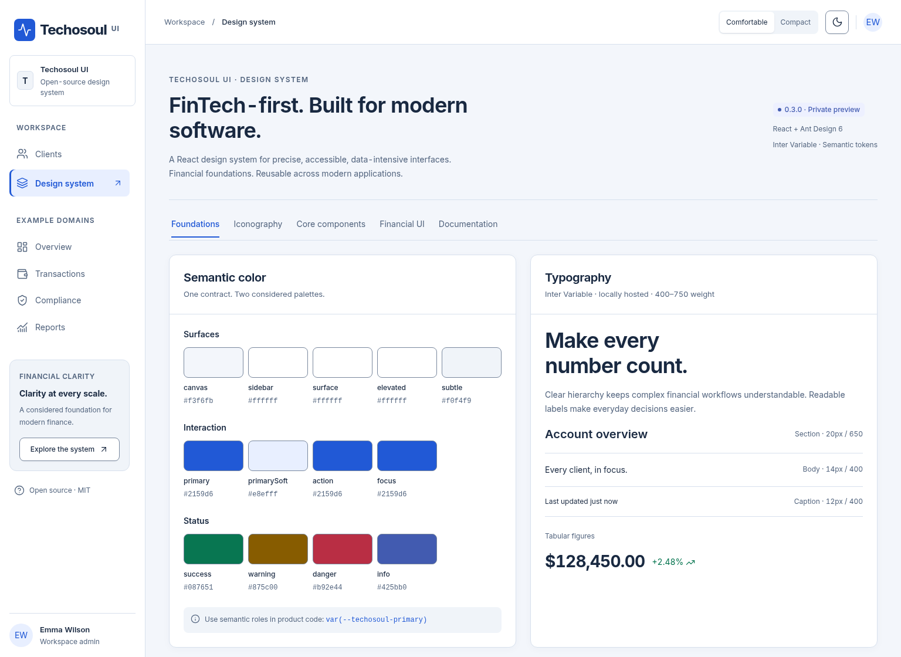
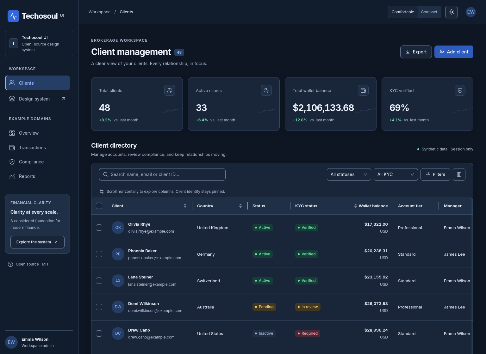
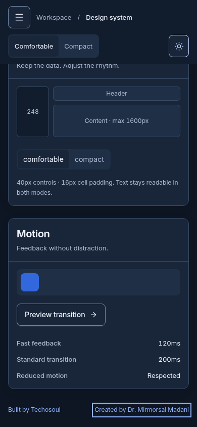

# Brand presentation preview

This editorial update starts from main `ac70d3d`, including the merged npm
release-readiness work. It keeps `@techosoul/ui@0.3.0` and the monorepo root private.
The live Pages deployment is not changed by this PR.

## README opening

> **Techosoul UI**
>
> **FinTech-first. Built for modern software.**
>
> An open-source React design system for precise, accessible, data-intensive
> interfaces. Techosoul UI combines Ant Design 6 controls with semantic tokens,
> financial display components and consistent interaction patterns.

[Preview the full README](../README.md). It leads with the working Showcase and
onboarding links, explains the FinTech focus, links
[Research & Design Decisions](design-rationale.md), then covers components,
installation, examples, the brand, its founder and contribution/attribution.
The package README is generated by the existing library build with absolute
GitHub/raw-image URLs; it is not maintained as a second editorial source.

## Current browser captures

Captured from the local running application in Chromium on **19 October 2026
(Europe/Warsaw)**, after the library build, with loaded fonts and reduced motion.
These show the branch's implementation, not a claim about the deployed version.

| File                                   | View                     | Theme / density     | Viewport    |
| -------------------------------------- | ------------------------ | ------------------- | ----------- |
| `screenshots/brand-showcase-light.png` | Foundations              | Light / Comfortable | 1536 × 1120 |
| `screenshots/brand-crm-dark.png`       | Brokerage CRM example    | Dark / Comfortable  | 1536 × 1120 |
| `screenshots/brand-mobile.png`         | Showcase and attribution | Dark / Comfortable  | 390 × 844   |

The mobile capture scrolls the existing main region to the small attribution
footer. The footer belongs only to the Showcase; no consumer application branding
is injected. Original screenshots and historical reports remain unchanged.

## Editorial review

The founder's education, current CPO role, experience and professional links, and
the description of Techosoul's professional community follow the owner's supplied
copy. Their final public presentation is included for owner editorial sign-off.
No clients, headcount, partnerships or legal company status have been added.

The registered corporate domain is described as a future website without a live
marketing link. No logo is created. The rationale separates historical project
evidence from interpretation and makes no external study or competitor-comparison
claims. Remaining technical limitations stay in the existing documentation.

## Validation

The PR records actual final-commit build, docs, package-inspection, independent
consumer, browser and complete CI results. Historical validation reports are not
updated with new counts. Release gates, CI workflows, palettes, typography,
component APIs, license and third-party notices are preserved.
